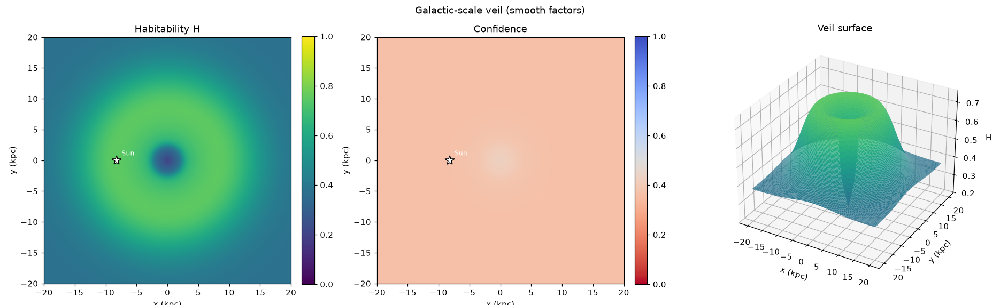
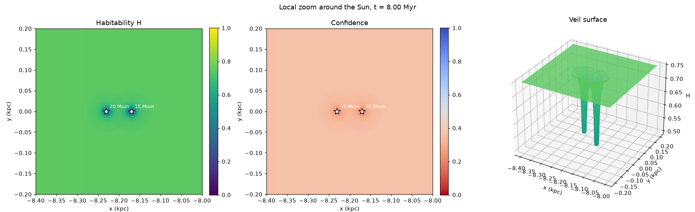

# The Drake Display

**A hazard-aware, four-dimensional extension of the Drake equation — mapping where, and *when*, the Milky Way could hold life.**

---

The Drake equation asked how many civilizations might share our galaxy. It was a way of turning a dinner-table argument into something you could actually reckon with. The Drake Display picks up where that left off and adds the two dimensions the original equation never had: **space and time.** Not *how many* worlds, but *where* — and *when*.

Imagine a translucent veil draped across the disk of the galaxy. Where conditions favor life, it rises; where a hazard lurks — a massive star spiraling toward collapse, the crowded violence of the core, the metal-starved outer dark — it dips. Overlapping influences compound. And then you reach for a slider marked *time*, and the whole surface begins to move: the habitable galaxy forming, shifting, and reshaping itself across billions of years as heavy elements spread outward and the early universe's gamma-ray storms subside.

That is what this project builds. Not an artist's impression — a **model**, grounded in real astronomical data where it exists, honest speculation where it doesn't, and a clear, visible line between the two.

*(The name is a nod to Frank Drake. The veil is the surface you see; the Display is the instrument that computes it.)*

## What this is

The Drake Display has two intertwined tracks, and neither works without the other:

- **A modeling engine** — an interactive, rotatable, zoomable 3D map of the Milky Way with a fourth axis, time. Each entity (star, planet, remnant, hazard) is a clickable object; the "veil" is a computed probability field describing habitability at every point, deforming as factors compound and as the clock runs.
- **A research library** — a growing collection of rigorous, source-cited science documents (stellar physics, galactic chemical evolution, the gamma-ray-burst and supernova hazard census, the bioenergetics of starlight, and more) that supply and justify every coefficient the model uses. The research calibrates the tool; the tool exposes which research still needs doing. One loop, not two projects.

## The core idea

Habitability is not uniform, and it is not eternal. It has a **geography** and a **history**. This project treats that literally:

- A **log-odds factor model** combines many positive and negative influences into a single valid probability field — so effects compound the way independent evidence should, without ever breaking the bounds of probability.
- Each factor carries not just a magnitude but a **science-backing weight**, so the map encodes *how much we trust each height*, not merely the height itself.
- A **time dimension** lets the model evolve: stars ignite, age, and die; enrichment spreads; hazards flare and fade. The habitable galaxy is something you watch happen.

## What makes it different

**Intellectual honesty is a first-class feature, not an afterthought.**

- Every equation is rated by certainty — from *Fundamental* physical law down to *Construct* (an explicit modeling choice) and *Missing* (a gap we refuse to paper over).
- The map is designed to **shade observed regions differently from modeled and speculative ones**. Most of the galaxy's data is inferred or synthetic — because we sit inside the disk, behind dust, unable to photograph our own galaxy from outside — and the Display shows you exactly where knowledge ends and extrapolation begins. That distinction is the difference between an instrument and a pretty lie.
- Gaps are named, not hidden. The project maintains explicit lists of the equations and parameters we *don't yet have*, each tied to the research that would supply it.

## The science it stands on

Real data, real physics, real uncertainty:

- **Astrometry & catalogs** — Gaia (1.8 billion stars now; the DR4 exoplanet and binary release lands December 2026), plus ready-made 3D star catalogs, spectroscopic metallicity surveys, and hazard registries.
- **Real equations on observable inputs** — luminosity and habitable zones from magnitude, parallax, and temperature; a stellar-lifetime clock for hazard timing; a metallicity gradient across the disk; supernova and gamma-ray-burst lethality from the peer-reviewed literature.
- **Honest limits** — some quantities (a lone star's mass and age, a supernova's exact collapse date) are *inferred* or *statistical*, never measured. The model treats them accordingly rather than pretending otherwise.

## Project structure

The repository is organized as layers that build on one another. **New here? Start with [NAVIGATION.md](NAVIGATION.md)** — a guided tour of every folder and suggested reading paths. Every document is catalogued, with its status and purpose, in [`docs/documents.toml`](docs/documents.toml).

| Folder | What's in it |
| --- | --- |
| [`docs/research/`](docs/research/) | **Research library** — the science documents that justify the model |
| [`docs/model/`](docs/model/) | **Model definition** — the veil spec, entity schema, equations with certainty ratings, and factor definitions |
| [`docs/data-sources/`](docs/data-sources/), [`docs/schemas/`](docs/schemas/) | **Data** — where the data comes from, and how every field and its confidence is described |
| [`docs/engineering/`](docs/engineering/) | **Build plans** — the Phase 0 spec and the end-to-end pipeline design |
| [`docs/code/`](docs/code/) | **Code documentation** — architecture, API references, configs, CLI, testing, extending |
| [`docs/project/`](docs/project/) | **Project management** — charter, roadmap, decision log, changelog, governance, to-do list |
| [`src/`](src/), [`tests/`](tests/), [`configs/`](configs/), [`data/`](data/), [`scripts/`](scripts/) | **The engine** — code, tests, model configs, curated data, and helper scripts |

## Status & roadmap

The project is in active design, **fully specified ahead of implementation** — the model, data schema, equation set, and build plan exist before the first line of engine code, by intent.

- **Phase 0 — Prove the model.** Python proof-of-concept: the field math, the coordinate pipeline, and a first time-evolving hazard. *(Built and calibrated — see [Running Phase 0](#running-phase-0).)*
- **Phase 1 — Interactive 3D.** A real rotatable, zoomable, clickable browser application.
- **Phase 2 — The fourth dimension.** A fully populated galaxy you can scrub through time.
- **Phase 3 — Real data & honest provenance.** Survey data at scale, with observed-vs-modeled shading.
- **Phase 4 — Polish & share.** Live tuning, deep entity views, saveable scenarios.

Each phase is independently valuable. You can stop at any boundary and still hold something worth having.

## Running Phase 0

Requires Python 3.11+.

```bash
python -m venv .venv && source .venv/bin/activate
pip install -r requirements.txt && pip install -e '.[dev,phase0]'
python src/main.py          # or: python -m veil   (--help for options)
python src/main.py --project-hazards   # local view with every nearby hazard projected onto the plane
pytest                      # unit + Phase 0 acceptance tests
```

The first run downloads the HYG v4.1 star catalog and the NASA Exoplanet Archive table into `data/raw/` (with retrieval dates in `data/raw/retrieved.json`). Output goes to `output/phase0/`: `veil.html`, a self-contained interactive page with a rotatable veil, hoverable entities and a time slider, plus static PNGs for quick validation.

**Height is habitability H; color is confidence** (blue = established, purple = mixed, red = speculative). Every value in the entity table carries its own provenance tier and confidence (ADR-011), shown in the hover text. The galactic view shows the favorable annulus carved by the metallicity band against the inner density and core penalties — H ≈ 0.2 at the core, peaking ≈ 0.75 at the Sun's radius, ≈ 0.4 at the edge (calibration targets, ADR-013):



Overlapping hazards compound: in the local demo below, two massive stars' dips overlap, and the log-odds sum deepens the trough between them without ever leaving [0, 1]. The 20 M☉ star has already exploded and is recovering, while the 15 M☉ star is still approaching collapse:



What each module does:

| Module | Role |
| --- | --- |
| `src/fields/` | The model library: kernels × distance metrics → spatial profiles; `Factor` (sign × backing × magnitude × f × g); `LogOddsField` (H and confidence in one pass); time profiles; grids; TOML config loading with FATAL/CORRECTABLE validation; matplotlib rendering |
| `src/veil/fetch.py` | Downloads raw catalogs and records retrieval dates |
| `src/veil/coords.py` | ICRS → galactocentric x, y, z via astropy, Sun pinned at R₀ = 8.2 kpc, z₀ = 20 pc |
| `src/veil/ingest.py` | Raw catalogs → one entity table per `entity.md`, with per-field confidences from the source field maps |
| `src/veil/registry.py` | Galactic factors from `configs/phase0-galactic.toml`, plus one supernova factor per massive star |
| `src/veil/interactive.py` | The Plotly page |
| `src/veil/main.py` | The single entry point |
| `data/curated/phase0_hazard_stars.csv` | Hand-entered masses and **scenario** collapse times for 18 nearby massive stars (speculative, low confidence) |
| `scripts/phase0_static.py` | Static renders of the synthetic two-star demo in `configs/phase0-local.toml` |

**Known Phase 0 limits.** The metallicity→habitability curve is a placeholder (EQ-CHEM-3), so the solar peak is partly built in; factor magnitudes are calibrated to explicit, reviewable targets (ADR-013 and `scripts/calibrate_phase0.py`), which are legibility judgments rather than measurements; massive-star collapse times are a scenario, not a prediction; by default the local view is a true slice through the Sun's plane, so hazards more than ~50 pc off it leave no dip there — `--project-hazards` shows them all, at the cost of overstating their reach (ADR-014).

## Getting involved

This project sits at the intersection of astrophysics, data visualization, and hard-science-fiction worldbuilding — and it welcomes people from all three. Whether you want to argue about a coefficient, contribute a factor, sharpen a piece of the science, or help build the engine, there's a place for you. Start a conversation in **Discussions**, read [`docs/CONTRIBUTING.md`](docs/CONTRIBUTING.md), or open an issue.

## Why it exists

Beneath the astrophysics, this is a worldbuilding instrument. It was born to give a work of science fiction a galaxy whose habitable geography is *non-arbitrary* — where civilizations, migrations, and catastrophes sit where the physics actually supports them, and where a knowledgeable reader finds ground solid enough to trust. The ambition outgrew the story. What began as research for a novel became a model of the living galaxy in its own right.

---

*The Drake Display maps a galaxy that is only now, after thirteen billion years, becoming truly habitable — and whose best age for life may lie in the deep future. Come help chart it.*
