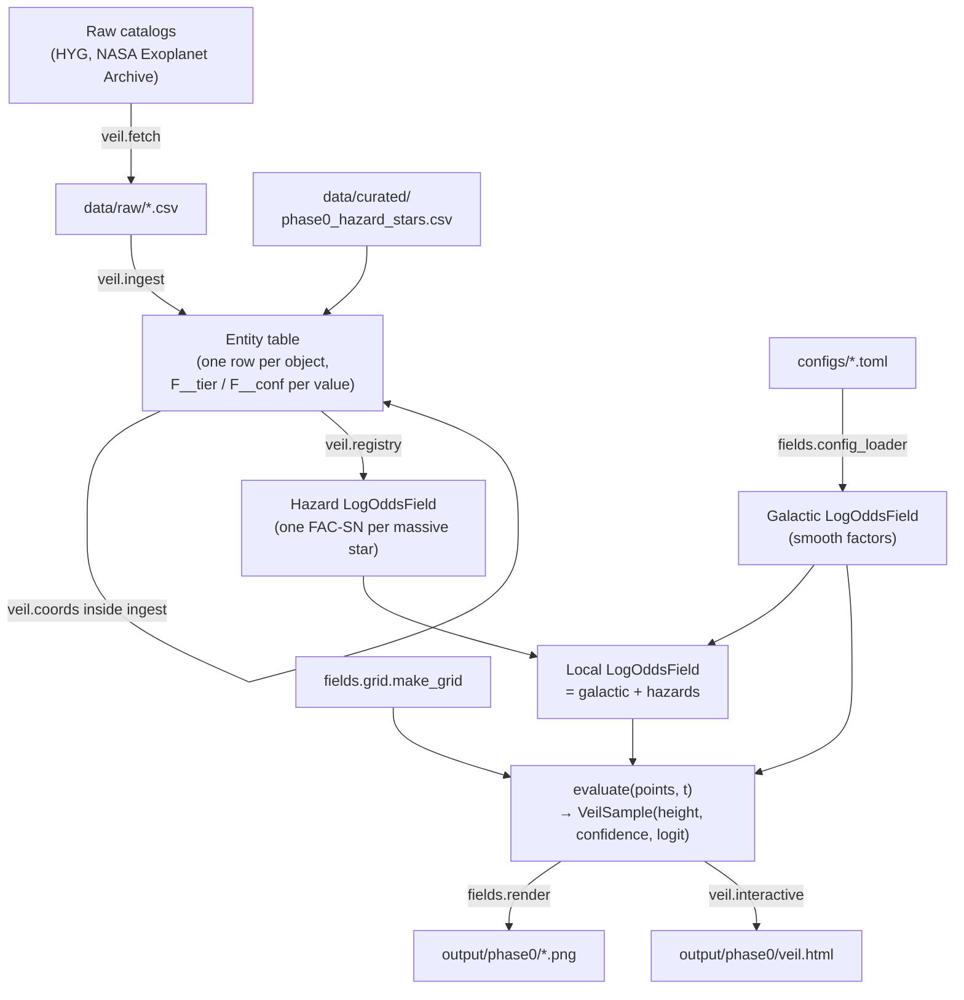

# Code Architecture

How the engine is put together, and the conventions every module follows. Start here before reading any of the other code guides.

**The other code guides:**

| Guide | Read it when you need to… |
| --- | --- |
| [`code-fields-reference.md`](code-fields-reference.md) | look up a class or function in the `fields` library |
| [`code-veil-reference.md`](code-veil-reference.md) | look up a function in the `veil` pipeline, or a column in the entity table |
| [`code-config-reference.md`](code-config-reference.md) | write or read a TOML model config |
| [`code-cli-reference.md`](code-cli-reference.md) | run the engine or the helper scripts |
| [`code-testing.md`](code-testing.md) | run, read, or add tests |
| [`code-extending.md`](code-extending.md) | add a new kernel, time profile, factor, or data source |

---

## What the code computes

The engine computes the **veil**, a habitability value *H* between 0 and 1 at every point of a grid over the galaxy, at a chosen time *t*.

Each **factor** (metallicity, stellar density, a supernova, …) adds a term to a log-odds sum:

```text
ℓᵢ(point, t) = signᵢ · backingᵢ · magnitudeᵢ · fᵢ(point) · gᵢ(t)

logit(H) = B₀ + Σᵢ ℓᵢ            (EQ-CORE-1)
H        = 1 / (1 + e^−logit)     (EQ-CORE-2)
```

- `sign` is +1 if the factor raises habitability, −1 if it lowers it.
- `backing` is how well the science supports the factor (0–1).
- `magnitude` is its strength.
- `f(point)` is its shape in space; `g(t)` is its shape in time.
- `B₀` is the baseline.

Adding in log-odds space means overlapping factors compound, while *H* can never leave [0, 1].

The same pass produces a second output, **confidence** (EQ-CORE-4). Each factor's confidence is its backing times its least-trusted input. Confidence at a point is the average of those, weighted by how much each factor contributes there. Height shows *how habitable*; confidence (rendered as color) shows *how much to trust that height*.

The full model definition is in [`docs/model/`](../model/). This code implements it.

---

## Two packages

```text
src/
├── fields/     a general library for scalar fields over space and time
└── veil/       the Phase 0 pipeline that applies fields to the galaxy
```

**`fields` knows nothing about astronomy.** It deals in points, distances, falloff shapes, time profiles, and log-odds sums. A few of its kernels are named after galactic quantities (`MetallicityBandKernel`), but they are pure functions of a distance and work anywhere.

**`veil` is the astronomy.** It downloads catalogs, converts coordinates, builds the entity table with provenance, turns entities into factors, and renders the result.

The dependency runs one way: `veil` imports `fields`; `fields` never imports `veil`. Keep it that way. It's what lets the field math be tested without catalogs, and reused without the galaxy.

---

## Data flow



`veil.main.main()` runs this whole flow, in this order:

1. Fetch any missing catalog.
2. Load the entity table.
3. Check the Sun lands at R = 8.2 kpc.
4. Build the fields.
5. Render the static images.
6. Render the HTML page.

---

## Module map

### `fields`

| Module | Responsibility |
| --- | --- |
| `kernels.py` | **Falloff shapes.** A `Kernel` turns distances into weights. Gaussian, inverse-square, compact support, constant, exponential, logistic step, metallicity band, truncated inverse-square |
| `distance.py` | **Distance measures.** A `DistanceMetric` turns points plus a center into distances. Euclidean, anisotropic (ellipse), cylindrical (in-plane), disk-scaled |
| `source_field.py` | **`SourceField`** = distance metric + kernel + center + weight. A single spatial influence |
| `composite_field.py` | **`CompositeField`** — the plain sum of several `SourceField`s |
| `temporal.py` | **Time profiles** `g(t)`: static, and ramp–spike–decay for a star approaching collapse. Also `ms_lifetime_myr` |
| `factor.py` | **`Factor`** — one log-odds term: spatial profile × sign × backing × magnitude × time profile, plus its input confidences |
| `log_odds_field.py` | **`LogOddsField`** — sums factors in log-odds space and returns height, confidence and logit together |
| `grid.py` | **Evaluation grids** for the galactic (±20 kpc) and local (±0.2 kpc) regimes |
| `config_validation.py` | **Checks a parsed TOML config** and reports every problem at once, as FATAL or CORRECTABLE |
| `config_loader.py` | **Reads a TOML file**, validates it, and builds the field objects |
| `render.py` | **Static matplotlib images**, for quick visual checks |
| `_naming.py` | Fallback names for unnamed factors (internal) |

### `veil`

| Module | Responsibility |
| --- | --- |
| `fetch.py` | Downloads missing raw catalogs into `data/raw/` and logs retrieval dates |
| `coords.py` | ICRS (ra, dec, distance) → galactocentric x, y, z in kpc, via astropy |
| `ingest.py` | Raw catalogs → the unified entity table, with per-field provenance |
| `registry.py` | Entities + configs → `LogOddsField`s; evaluates the field at entity positions |
| `interactive.py` | The Plotly HTML page |
| `main.py` | The command-line entry point that wires everything together |

`src/main.py` is a three-line wrapper so `python src/main.py` works. `veil/__main__.py` makes `python -m veil` work.

---

## Conventions

### Array shapes

Every spatial function takes **points of shape `(..., D)`**: any number of leading dimensions, with coordinates on the last axis. It returns **values of shape `(...)`**, one per point.

- A single point is `(1, 3)`.
- A list of entity positions is `(N, 3)`.
- A grid is `(ny, nx, 3)`.

Nothing in `fields` loops over points in Python; everything is vectorized NumPy.

A center is a single point, shape `(D,)`. Points and center must share `D`. Most of `fields` works in any dimension. The cylindrical and disk-scaled distances read the first two coordinates as the plane and the third (if present) as height. `AnisotropicDistance.from_ellipse` builds a 2D metric.

### Units

| Quantity | Unit |
| --- | --- |
| Galactocentric position (x, y, z, R) | kpc |
| Heliocentric distance | pc |
| Time | Myr from now. The slider runs forward from t = 0; negative times are the past |
| Mass | solar masses |
| Temperature | K |

Unit suffixes are part of the names (`distance_pc`, `t_birth_myr`, `half_width_kpc`). Keep that habit; it's the main defense against unit bugs.

### Coordinate frame

Galactocentric Cartesian, with the galactic center at the origin and the Sun at about (−8.2, 0, +0.02) kpc. The Sun's position is pinned to the model's own constants (`veil.coords.R0_KPC`, `Z0_PC`), not astropy's defaults, so the frame and the radial profiles agree.

### Missing values and provenance

- **Unknown values are `NaN`, never zero.** Zero is a real value, and the field math must be able to tell the difference.
- **Every physical value in the entity table has two companion columns:** `F__tier` (Measured, Inferred, Statistical-only, Modeled or Speculative) and `F__conf` (0–1). They are filled exactly where `F` has a value.
- **A value with no stated provenance is Speculative / 0.10.** This is the fail-safe from [ADR-011](../project/DECISIONS.md) and [`schema-field-definition.md`](../schemas/schema-field-definition.md).

### Registries

Kernels, distance metrics and time profiles each have a **registry**: a dict from a config name to its class (`KERNEL_REGISTRY`, `DISTANCE_REGISTRY`, `TEMPORAL_REGISTRY`). Configs refer to them by name. Adding a new type touches its registry, the validator's required-parameter table, and the loader's builder table. [`code-extending.md`](code-extending.md) walks through it.

### Validation style

Config problems are collected, not raised one at a time. Validation returns a `ValidationReport` listing every issue, each marked as one of two kinds:

- **FATAL** means there is no safe default, so the config can't be built.
- **CORRECTABLE** means there is a safe default. It's applied and reported, never silently.

The loader raises `ConfigValidationError` only after printing the full report.

---

## Design decisions that shape the code

These are recorded in [`DECISIONS.md`](../project/DECISIONS.md). The ones that matter most when reading the code:

| ADR | Effect on the code |
| --- | --- |
| ADR-003 | Never use a catalog's own x/y/z columns. Always transform from ra/dec/distance |
| ADR-004 | Two grids, galactic and local, instead of one adaptive grid. Point hazards only appear on the local grid |
| ADR-011 | Per-field provenance with a Speculative/0.10 default; confidence is a second output of the field |
| ADR-013 | Baseline and magnitudes are calibrated to explicit targets, and guarded by `tests/test_calibration.py` |
| ADR-014 | The local view is a true 3D slice by default; `--project-hazards` is opt-in |
